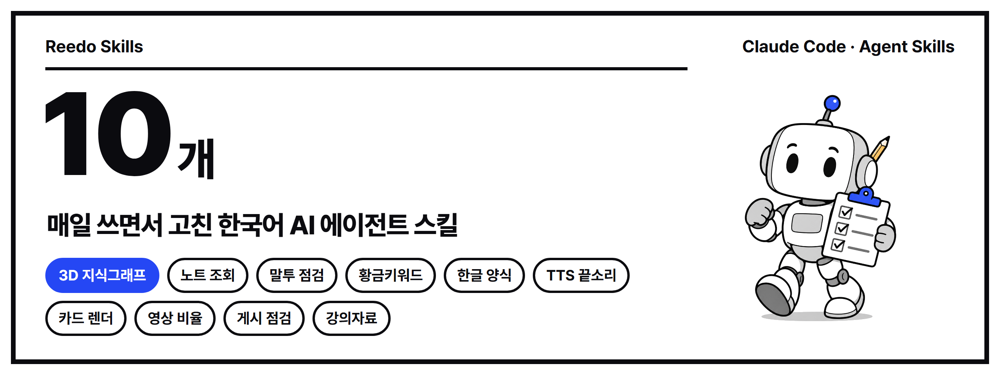
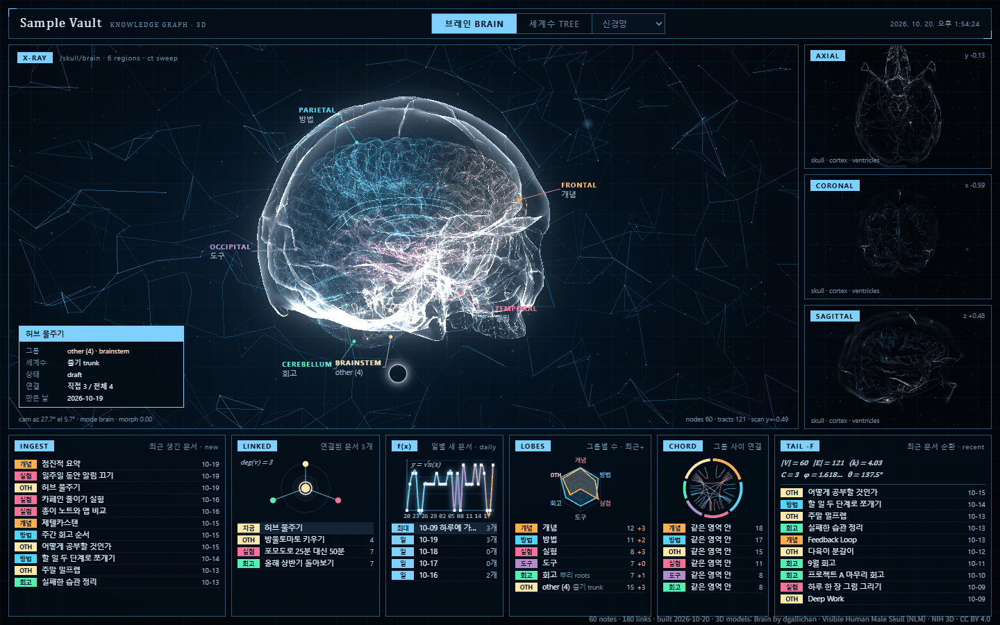

<p align="center"></p>

<p align="center">
<a href="https://github.com/reedodev/reedo-skills/actions/workflows/test.yml"></a>


</p>

# Reedo Skills

블로그, SNS, 영상, 서류 작업을 AI 에이전트에게 맡기면서 실제로 막혔던 부분을 고쳐 가며 만든 [Claude Code](https://docs.claude.com/en/docs/claude-code) 스킬 모음입니다. 한국어 사용자가 자주 부딪히는데 영어권 스킬에는 잘 없는 문제(존댓말·반말이 섞이는 글, 네이버 키워드, 한글 HWPX 서식)와, 에이전트가 "다 했습니다"라고 말하고 빠뜨리는 마무리 확인을 먼저 골랐습니다.

> English summary is [below](#english).

<p align="center"></p>

## 스킬 목록

### 지식 (knowledge-skills)
| 스킬 | 하는 일 | 필요한 것 |
|---|---|---|
| [obsidian-brain-3d](skills/obsidian-brain-3d) | 옵시디언 보관함을 엑스레이 뇌·두개골 속 점으로 보여 주고, `T` 키로 세계수 모양으로 바꿉니다. 아래 여섯 칸에는 실제 노트 제목·날짜·연결 수가 나옵니다 | Node 18+, 브라우저 |
| [vault-recall](skills/vault-recall) | 일을 시작하기 전에 보관함에서 이번 작업과 관련된 지난 교훈·실패 기록을 찾아 먼저 읽게 합니다 | Node 18+ |
| [work-to-lecture-deck](skills/work-to-lecture-deck) | AI와 나눈 실제 작업 기록을 '사람이 한 일 / AI가 한 일' 흐름표와 단계 카드로 된 HTML 강의자료로 만듭니다 | Node 18+ |

### 한국어 크리에이터 (korean-creator-skills)
| 스킬 | 하는 일 | 필요한 것 |
|---|---|---|
| [korean-tone-check](skills/korean-tone-check) | 글에 섞인 반말·존댓말 종결을 찾아내고, AI 티가 나는 상투어·번역투·짧은 문장 나열을 표시합니다 | Node 18+ |
| [naver-golden-keywords](skills/naver-golden-keywords) | 월간 검색량과 블로그 문서수로 경쟁률을 계산해 S·A·B 등급 황금키워드를 고릅니다 | Node 18+, 네이버 API 키 |
| [hwpx-form-fill](skills/hwpx-form-fill) | 한컴오피스 없이 한글(HWPX) 양식의 표 칸을 라벨로 찾아 채우고, 이미 채워진 칸은 지키며, 다시 열어 검증합니다 | Python, `python-hwpx` |
| [tts-tail-fix](skills/tts-tail-fix) | AI 음성의 마지막 음절이 뚝 끊기는 문제를 버리는 단어(센티널)와 끝 페이드로 고치고 검사합니다 | Python, `numpy`, `soundfile` |
| [html-card-render](skills/html-card-render) | 카드뉴스·배너·썸네일을 HTML로 짜서 크롬으로 정확한 픽셀 크기의 PNG로 찍고, 글자 넘침을 자동 검사합니다 | Node 22+, 크롬/엣지 |
| [social-video-gate](skills/social-video-gate) | 릴스·쇼츠·틱톡·유튜브에 올릴 영상의 **화면에 보이는** 비율을 회전 정보와 픽셀 비율까지 계산해 검사합니다 | Node 18+, ffprobe |
| [youtube-publish-checklist](skills/youtube-publish-checklist) | 롱폼·쇼츠마다 맞춤 썸네일과 고정 댓글(예약 공개면 후속 작업)을 확인하기 전에는 "게시 완료"라고 하지 못하게 합니다 | Node 18+ |

## 설치

**Claude Code 플러그인으로 설치**

```
/plugin marketplace add reedodev/reedo-skills
/plugin install korean-creator-skills@reedo-skills
/plugin install knowledge-skills@reedo-skills
```

**필요한 스킬만 직접 복사**

```bash
git clone https://github.com/reedodev/reedo-skills.git
cp -r reedo-skills/skills/obsidian-brain-3d ~/.claude/skills/
```

설치한 뒤에는 "내 옵시디언을 3D 뇌로 보여 줘", "이 글 존댓말로 통일됐는지 봐 줘", "이 hwpx 신청서 채워 줘"처럼 평소 말투로 요청하면 에이전트가 맞는 스킬을 골라 씁니다.

## 바로 해 보기

```bash
# 3D 지식그래프: 들어 있는 가상 노트 60개로 화면을 띄웁니다
node skills/obsidian-brain-3d/scripts/build-data.mjs skills/obsidian-brain-3d/examples/sample-vault --site ./brain-site
node skills/obsidian-brain-3d/scripts/serve.mjs ./brain-site      # http://127.0.0.1:8770/

# 말투 검사: 예시 글에 섞인 반말 3문장을 찾아냅니다
node skills/korean-tone-check/scripts/check-tone.mjs skills/korean-tone-check/examples/sample.md --target hamnida

# 카드뉴스: 4:5 카드 3장을 2160x2700 PNG로 찍습니다
node skills/html-card-render/scripts/render.mjs skills/html-card-render/templates/card-4x5.html card.png --size 1080x1350 --scale 2 --pages
```

## 품질을 지키는 방법

- **모든 스크립트를 자동으로 시험합니다.** `node tests/run.mjs`가 스킬 10개의 스크립트를 예시 파일로 실제 실행하고, 푸시할 때마다 GitHub Actions가 우분투에서 같은 시험을 돌립니다(위 test 배지). `tests/lint-skills.mjs`는 SKILL.md 형식(이름 규칙, 설명 길이, 500줄 제한, 플러그인 목록 누락)을 검사합니다.
- **언제 불려야 하는지도 시험 목록이 있습니다.** `evals/triggers.json`에 스킬마다 "이 말이면 써야 한다 / 이 말이면 쓰면 안 된다" 예시를 적어 두어, 설명을 고친 뒤 새 대화에서 확인할 수 있습니다.
- **조용히 성공한 척하지 않습니다.** 칸을 못 찾았거나, 이미 내용이 있는 칸이거나, 끝소리가 끊겼거나, 비율이 틀렸거나, 고정 댓글 확인이 빠졌으면 종료 코드 1로 멈춥니다.
- **꾸며 내지 않고, 키와 개인정보를 출력하지 않습니다.** 글을 고칠 때 없는 경험이나 수치를 만들지 않고, API 키는 `.env`에만 둡니다. 3D 지식그래프에는 공개용으로 제목·그룹 이름을 가리는 옵션이 있습니다.

## 다른 프로젝트와 함께 쓰기

이 저장소는 같은 문제를 다루는 더 큰 프로젝트를 대신하려는 것이 아니라, 그 옆에서 쓰는 작은 도구에 가깝습니다.

- 한국어 글 전체를 깊게 윤문하려면 [epoko77-ai/im-not-ai](https://github.com/epoko77-ai/im-not-ai)가 훨씬 넓은 분류 체계를 갖고 있습니다. `korean-tone-check`는 발행 직전에 말투 섞임을 기계적으로 막는 빠른 관문입니다.
- 한글 문서를 새로 만들거나 크게 편집하려면 [jkf87/hwpx-skill](https://github.com/jkf87/hwpx-skill), [airmang/hwpx-plugins](https://github.com/airmang/hwpx-plugins)를 함께 보세요. `hwpx-form-fill`은 이미 있는 양식의 칸을 안전하게 채우는 일에만 집중합니다.

## 고마운 프로젝트

- [airmang/python-hwpx](https://github.com/airmang/python-hwpx), [ebandal/H2Orestart](https://github.com/ebandal/H2Orestart), [neolord0/hwp2hwpx](https://github.com/neolord0/hwp2hwpx): 한글 파일 읽기·쓰기·변환
- [three.js](https://threejs.org/) (MIT), NIH 3D의 뇌·두개골 모델(CC BY 4.0, 출처는 [CREDITS](skills/obsidian-brain-3d/viewer/CREDITS.md)): 3D 지식그래프
- [Pretendard](https://github.com/orioncactus/pretendard), [Gaegu](https://fonts.google.com/specimen/Gaegu): 글꼴(SIL OFL 1.1, 저장소에는 넣지 않고 필요할 때 받습니다)
- [anthropics/skills](https://github.com/anthropics/skills): 스킬 구조와 플러그인 형식

## 만든 사람

**리도**, AI 좌충우돌 실습 중인 20년차 엔지니어입니다. AI로 직접 해 본 작업과 고친 과정을 영상과 글로 남기고 있습니다.

[YouTube @Reedodev](https://www.youtube.com/@Reedodev) · [Threads @reedo.dev](https://www.threads.com/@reedo.dev) · [링크 모음](https://links.metacint.com/)

버그나 개선 아이디어는 [Issues](https://github.com/reedodev/reedo-skills/issues)에 남겨 주세요.

---

## English

Ten [Claude Code](https://docs.claude.com/en/docs/claude-code) skills I built while handing blog, social, video and paperwork tasks to AI agents. Each one was fixed after it broke in real use. Every script is exercised by `tests/run.mjs` and GitHub Actions on each push.

| Skill | What it does |
|---|---|
| `obsidian-brain-3d` | Renders an Obsidian vault as points inside an x-ray brain and skull (press `T` for a world-tree layout), with real note titles, dates and link counts in six panels. Optional title/group hiding for public sharing. |
| `vault-recall` | Before a task, finds relevant past lessons in your vault (Korean-aware bigram search, status and recency weighting, cached index; 8k notes in under a second after the first run). |
| `work-to-lecture-deck` | Turns real AI work logs into a single-file HTML lecture deck with a human/AI swimlane and per-step cards. |
| `korean-tone-check` | Flags mixed Korean speech levels, stock AI phrases, translationese and choppy sentence runs. Exits 1 on speech-level mismatches. |
| `naver-golden-keywords` | Scores Naver blog keywords by monthly searches vs. blog document count using the official Search Ad and Search APIs. |
| `hwpx-form-fill` | Fills Hangul (HWPX) form tables by label without Hancom Office, refuses to overwrite filled cells, re-opens the file to verify. |
| `tts-tail-fix` | Detects and fixes TTS clips whose last syllable is cut off (sentinel word, cut at the pause, fade at the real end). |
| `html-card-render` | Zero-dependency HTML to PNG renderer over the Chrome DevTools Protocol with exact pixel sizes and an in-page overflow check. |
| `social-video-gate` | Checks the displayed aspect ratio of a video (rotation metadata and non-square pixels included) for Reels, Shorts, TikTok or YouTube. |
| `youtube-publish-checklist` | Per-video gate: custom thumbnail (size, ratio, shown on channel) and pinned comment, with a follow-up task for scheduled releases. |

Install with `/plugin marketplace add reedodev/reedo-skills`, then `/plugin install korean-creator-skills@reedo-skills` and/or `/plugin install knowledge-skills@reedo-skills`, or copy a folder from `skills/` into `~/.claude/skills/`.

MIT License. Third-party models, fonts and libraries keep their own licenses.
